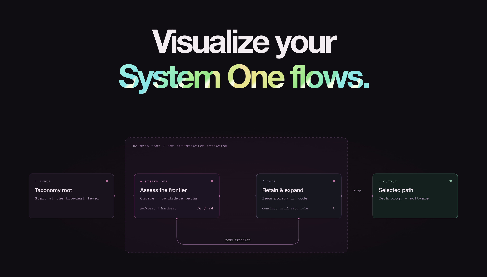

<div align="center">

# Jev DevTools

A React inspector for TypeSafe Jev requests captured through a Node server adapter.<br />
Inspect request inputs, returned answers and probabilities, retries, and errors.

[](https://www.npmjs.com/package/jev-devtools/v/0.5.4)
[](https://github.com/diegoag64/jev-devtools/actions/workflows/ci.yml)
[](#add-to-your-app)
[](https://docs.jevtools.dev/guides/nextjs/)
[](LICENSE)
[](#add-to-your-app)

[Website](https://jevtools.dev/) · [Documentation](https://docs.jevtools.dev/) · [API reference](https://docs.jevtools.dev/api/reference/)

</div>

[](https://jevtools.dev/)

## What you can inspect

| View                  | What it shows                                                                     |
| --------------------- | --------------------------------------------------------------------------------- |
| Questions and answers | Choice probability bars, Score values, Noul probabilities, and Box regions.       |
| Context               | Captured request inputs, including expandable structured values.                  |
| Request history       | Searchable calls with Flow, Questions, Context, Transport, and Raw views.         |
| Transport             | Attempts, retries, errors, and cancellation alongside each request.               |
| Connected flows       | Requests, dependencies, parallel steps, evaluated conditions, and named outcomes. |

Use the optional `jev-devtools/flow` API to connect requests and application steps in a diagram. Request inspection works without adopting flows.

Diagrams show captured inputs, responses, and routing rules you define. They do not expose hidden model reasoning or infer policies from unrelated application code.

<a id="run-the-playground"></a>

## Try the local playground

Run labeled samples without an API key or inference calls. Use Node 22.12+. [Contributor setup](CONTRIBUTING.md) describes the pinned development runtime.

```sh
git clone https://github.com/diegoag64/jev-devtools.git
cd jev-devtools
npm ci
npm run dev
```

Open [the playground](http://127.0.0.1:4182/), run a sample scenario, and open **Jev DevTools**. Select the recorded request to inspect its inputs and answers. The [playground guide](apps/playground/README.md) covers scenarios, the edge-case sandbox, and optional live mode.

<a id="install-in-another-react-app"></a>

## Add to your app

Use matching React and React DOM **18.x or 19.x**, Node **22.12+**, TypeSafe SDK **0.7.x**, and ESM imports. TypeScript consumers need **5.4+** and compatible React and Node types. React and React DOM are required peers even in a server-only workspace. See [compatibility and public imports](docs/integration.md#compatibility-and-public-imports) for compiler settings and exact dependency ranges.

Install in each workspace that imports the package:

```sh
pnpm add jev-devtools @typesafe-ai/sdk
```

An integration connects three parts:

- One React drawer near your app's root. It supplies its own scoped styles and needs no CSS import, Tailwind, or shadcn.
- One shared Node server adapter for the inspector routes and application client.
- An instrumented client created with `inspector.createClient()` for your application's Jev calls. Only calls through that client are captured.

Both capture and display are opt-in and disabled by default. Enable both for development. Keep API keys on the server, and keep imports from `jev-devtools/server` and `jev-devtools/flow` out of browser code.

Use server-side redaction for data that must not reach the browser. The drawer's optional masking of personal fields affects display only. The underlying values remain in captured data. See the [redaction policy](docs/integration.md#redaction-policy).

The drawer receives updates over same-origin server-sent events. Match the adapter's `origin` to the browser URL, including scheme, hostname, and port. The adapter stores bounded history in one process. Edge runtimes and history aggregation across distributed or serverless instances are unsupported.

### React + Node

Follow the [React and Node quick start](https://docs.jevtools.dev/getting-started/) to mount the drawer, connect an Express server, and inspect a request. With separate Vite and backend ports, proxy `/api/jev-devtools` to the backend. The guide includes proxy configuration and verification steps.

Bind local development servers to `127.0.0.1`. For shared environments or tunnels, configure [authorization and access controls](docs/integration.md#history-and-access) before exposing the inspector. For a no-key integration example, use the [independent Vite app](examples/react-vite).

### Next.js App Router

Follow the [Next.js guide](https://docs.jevtools.dev/guides/nextjs/) to create a shared adapter with `getJevDevtools`, expose an optional catch-all Route Handler, and mount the drawer through a client component. Route Handlers, Server Actions, and Server Components must use the same adapter in the same Node process.

Keep `TYPESAFE_API_KEY` in the server environment and the shared adapter in a server-only module. Externalize `@typesafe-ai/sdk` and keep `jev-devtools` bundled so the drawer uses your app's React instance. Run the development server on `127.0.0.1` with a matching adapter origin, or configure real authorization for shared access.

The [repository Next.js guide](docs/nextjs.md) and [runnable example](examples/nextjs-app) include the complete configuration and runtime limits.

### Versions and local builds

**Source version: 0.5.4.** [See release notes for verified publication status.](https://github.com/diegoag64/jev-devtools/releases/tag/v0.5.4) Install published releases from npm. APIs remain experimental before 1.0. Check the [changelog](CHANGELOG.md) for compatibility and release status.

<details>
<summary>Install a packed checkout in your own app</summary>

After installing this repository's dependencies, pack the checkout and install its archive in your app:

```sh
# In this repository:
npm run pack:devtools

# In your React application:
npm install /absolute/path/to/jev-devtools/jev-devtools-0.5.4.tgz
```

The archive includes local code changes and the bundled setup skill. Keep the drawer and server adapter on the same build.

</details>

<a id="connected-jev-flows"></a>
<a id="define-and-visualize-connected-flows-with-jev-devtoolsflow"></a>

## Connect requests with flows

Define a flow on Node, then run it for each input. Typed answer references can feed later requests, conditions, and outputs. The API also supports server tasks, parallel steps, bounded collections, conditional paths that rejoin, and stateful loops.

This example asks whether a message is ready for review. An application-defined threshold selects an outcome. Reuse the instrumented `jev` client and shared `inspector` from your server integration. Running this example with a live client makes an inference request:

```ts
import { noul } from "@typesafe-ai/sdk";
import { defineJevFlow } from "jev-devtools/flow";

const review = defineJevFlow<{ message: string }>("review", (flow) => {
  const readiness = flow.jev("readiness", {
    state: flow.input,
    questions: {
      ready: noul("Does this message include enough detail to review?"),
    },
  });

  return flow.branch("route", {
    // Example application policy, not a threshold supplied by Jev.
    when: readiness.answer("ready").noul.gte(0.9),
    then: (path) => path.output("ready"),
    else: (path) => path.output("needs-detail"),
  });
});

const result = await review.run(
  { message: "Please review the attached proposal." },
  { client: jev, devtools: inspector },
);
console.log(result.outcome); // "ready" or "needs-detail", depending on the answer.
```

Open **Jev DevTools**, select **Flows**, and open the run. Inspect the returned probability and the condition that selected the path. Untaken paths remain visible. The flow returns an outcome. Your application decides what to do with it.

Runs support SDK retries and cancellation, with bounded in-memory inspector history. They do not provide durable workflow execution. Learn the API in [Flows from scratch](https://docs.jevtools.dev/guides/flow-basics/) or look up contracts in the [flow reference](docs/flows.md).

## Replay and compare runs

Replay and comparison require **0.5.0 or later**. Choose **Copy fixture** on a captured run to save its answers as JSON. Use `replayClient` from `jev-devtools/flow` to test routing against those saved answers without a Jev API key or inference calls. Map items and loop iterations replay their own answers. Tasks run again and may call outside services.

Use `compareWithFixture` to compare a run with saved answers, including routing and item steps. Comparison runs the flow with the client you supply and can make live inference calls. See the [replay and comparison reference](https://docs.jevtools.dev/api/flow/) for complete examples and fixture limits.

## Explore cookbook examples

The [cookbook collection](cookbooks/README.md) contains runnable adaptations of official TypeSafe recipes, including passage classification, skill selection, structured extraction, and memory. The examples use Flow APIs available since **0.4.0** and labeled sample responses. They run from this repository without an API key. Cookbook application code and fixtures are not bundled in npm.

## Set up with your coding agent

After installing, paste this into your coding agent while it has your app open:

```text
Set up jev-devtools in this app. Read
node_modules/jev-devtools/skills/setup-jev-devtools/SKILL.md
and follow the recipe for React with Node or Next.js. Connect server capture
and the root drawer, then verify with a labeled sample request.
Preserve existing behavior. For connected flows, also read references/flows.md
in that skill folder and preserve my routing rules.
```

Use the package directory visible to your app for guidance that matches its installed version. The [bundled setup skill](packages/jev-devtools/skills/setup-jev-devtools/SKILL.md) includes framework recipes and sample verification. Tools that support installed skills can copy the whole `setup-jev-devtools` folder, including `references/`. npm does not register it automatically. [llms.txt](llms.txt) indexes the documentation.

## Documentation

Use [docs.jevtools.dev](https://docs.jevtools.dev/) for setup guides and examples, and the [API reference](https://docs.jevtools.dev/api/reference/) for methods, options, and types. The [agent guide](https://docs.jevtools.dev/agents/) explains the available documentation formats.

Hosted docs are published separately from the package. Compare their version with your installed package and the [changelog](CHANGELOG.md). Prefer installed declarations and the bundled setup skill when versions differ. Detailed [integration](docs/integration.md), [Next.js](docs/nextjs.md), and [flow](docs/flows.md) references also live in this repository.

## Contributing

See [Contributing](CONTRIBUTING.md) for repository setup, layout, and verification. Changes use feature branches and pull requests. Merging, npm publication, and deployment each require explicit authorization. See the [architecture](docs/architecture.md) and [release process](docs/releases.md) for implementation and maintenance details.

[Report an issue](https://github.com/diegoag64/jev-devtools/issues) or [contribute a pull request](CONTRIBUTING.md).

<a id="documentation-app"></a>

### Website development

The [landing app guide](landing/README.md) and [docs app guide](apps/docs/README.md) cover their separate styles, builds, and local development. Run `npm run dev:docs` from the repository root to open the docs locally. Both sites require manual deployment, separate from package releases. Follow the [docs publishing policy](docs/docs-publishing.md) or the landing app's publishing instructions.

## Credits & license

Inspired by the TanStack Query DevTools workflow, with a custom drawer and TanStack Virtual for the Questions list. The TanStack DevTools shell is not included.

Diagram styling is based on [Cathryn Lavery's diagram-design](https://github.com/cathrynlavery/diagram-design). Jev DevTools is an independent, open-source community project. It is not affiliated with TypeSafe AI. TypeSafe branding belongs to its respective owner.

Project code is MIT licensed. See [LICENSE](LICENSE) and [third-party notices](THIRD_PARTY_NOTICES.txt) for design provenance and branding.
